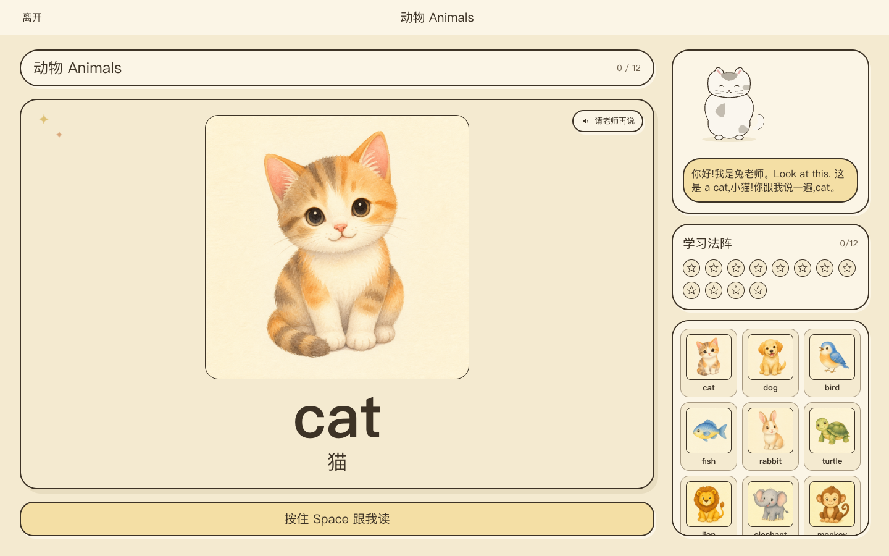
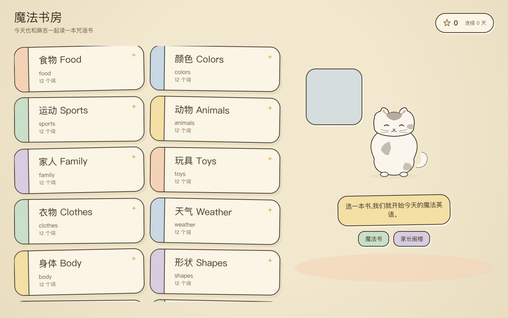
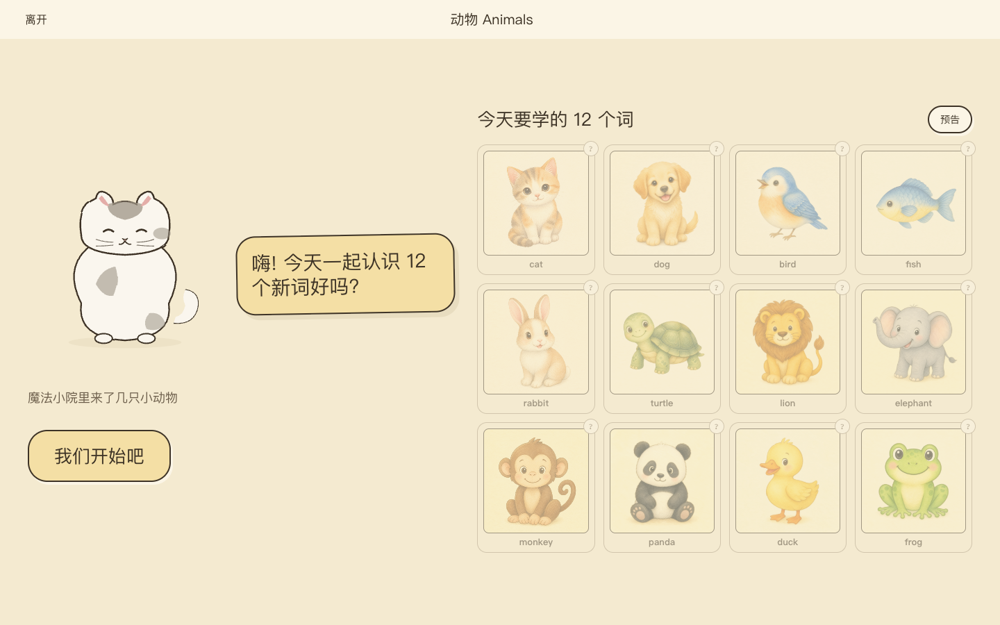

# EduAgent - 儿童英语教学 Agent / Children's English Teaching Agent

EduAgent 是支持 Mac 桌面版和本地浏览器开发的多模态儿童英语教学原型。它把浏览器端
push-to-talk 交互、Next.js 自定义 server、豆包流式 ASR/TTS、OpenAI 兼容 LLM(当前为 SiliconFlow DeepSeek)
和 SQLite 课堂日志串成一个可迭代的 teacher-agent 实验环境。

EduAgent is a Mac desktop and local-browser prototype for a multimodal English teaching agent
for children. It combines browser push-to-talk interaction, a custom Next.js
server, Doubao streaming ASR/TTS, an OpenAI-compatible LLM teacher loop (currently SiliconFlow DeepSeek), and SQLite lesson
logs into one iteration-friendly teaching-agent workspace.

> 当前项目定位 / Current scope:
> This is a local development prototype. It is not a hosted production service,
> mobile app, multi-user platform, or hardened auth product.

## 界面截图 / Screenshots

上课主界面 —— 词卡、老师语音气泡、学习进度,底部按住 Space 跟读。
The teaching screen: word card, teacher speech bubble, progress track, and
push-to-talk at the bottom.



课程选择与课前预告 / Course picker and pre-lesson preview:

| 魔法书房(选课) / Course picker | 课前预告 / Lesson preview |
| --- | --- |
|  |  |

我的魔法书 —— 已收集的词按课程分章展示。
The spellbook: collected words, grouped by course.


> 截图由 `pnpm screenshots` 生成(需先跑 `VOICE_MOCK=true pnpm dev`),UI 变化后重跑即可更新。
> Screenshots are generated by `pnpm screenshots` against a local
> `VOICE_MOCK=true pnpm dev` server; rerun it after UI changes.

## 给家长：安装 Mac 版

需要 Apple 芯片的 Mac。本次只提供 `arm64` 安装包，暂不提供 Intel Mac 版。
使用时需要联网，并使用你自己的模型和豆包语音服务 Key，服务费用由你承担。
没有登录账号，孩子档案只用于分开保存学习记录，资料和 Key 都保存在这台 Mac 上。

1. 从维护者提供的下载链接下载 `EduAgent-版本号-arm64.dmg`。在「关于本机」里可查看是否为 Apple 芯片。
2. 双击打开 dmg，把 **EduAgent** 拖进「应用程序」，再从「应用程序」打开它。
3. 安装包使用自签名证书。首次打开如果被 macOS 拦住，先关闭提示，再到「系统设置 → 隐私与安全性」，找到 EduAgent，点击「仍要打开」，按系统提示确认。
4. 首次引导先填写模型和豆包语音服务的 Key，点击「测试连接」，成功后保存。页面内提供申请指引，遇到服务未开通或鉴权失败时按提示检查。
5. 按引导点击「允许使用麦克风」，并在系统弹窗中允许。也可以稍后到应用的「设置 → 麦克风」完成授权，再点「试录一下」查看音量。
6. 建立第一个孩子档案，再选择课程。以后可在设置里新增或切换孩子，每个孩子的学习进度单独保存。

遇到问题时，在「设置 → 关于」点击「打开日志文件夹」，或使用应用菜单里的同名入口。
日志位于 `~/Library/Application Support/EduAgent/logs/server.log`。请先检查日志再分享，不要发送 Key 或 `settings.json`。
升级时退出 EduAgent，再把新版本拖进「应用程序」并选择替换，学习记录保留在本机数据目录中。

**真机截图待补**：dmg 拖入应用程序；首次被拦提示；「隐私与安全性 → 仍要打开」；填 Key 与测试连接；系统麦克风授权弹窗；新建孩子档案；打开日志文件夹。
这些位置需要从真实安装与系统授权流程截图，现有课程界面截图不能替代。另一台 Mac 的首次安装、真实语音上课，以及覆盖安装后授权是否保留仍需真机走查。

## 给开发者：打包 Mac 版

依赖 macOS、Node 26（见 `.nvmrc`）、pnpm（见 `packageManager`）、Xcode Command Line Tools
及 PATH 中可执行的 `cwebp`（由 WebP 工具提供，例如 `brew install webp`）。缺少工具时打包会明确报错，不会自动安装全局工具。
SQLite 使用 Node 内置 `node:sqlite`，无需安装或为 Electron 重编译 better-sqlite3。

```bash
pnpm install
# 每台打包机器首次执行，使用专用钥匙串，不修改 login 钥匙串
bash desktop/scripts/create-signing-cert.sh
pnpm app:release
pnpm app:e2e
pnpm app:verify-images
```

`app:release` 一次完成 standalone 构建、staging 图片转换、Electron 打包、自签名校验和 dmg 生成。
`app:pack` 是兼容入口。版本取根目录 `package.json`，Apple 芯片产物为
`desktop/dist/EduAgent-<version>-arm64.dmg`，应用位于 `desktop/dist/mac-arm64/EduAgent.app`。
App 图标:`desktop/build-resources/icon-source.png` 是 1024 方形水彩原画(Codex `image_gen` 绘制),改图后运行 `pnpm app:icon` 重新生成带 macOS 圆角和投影的 `icon.icns`,electron-builder 会自动使用。

签名证书、专用钥匙串和私钥保护步骤见 [Mac 签名与打包说明](docs/mac-signing.md)。不进行 Apple 公证或自动发布。

仓库 PNG 和课程的 `imageUrl` 保持不变。仅 App staging 使用 `cwebp -q 82` 转成 WebP，
仅 `EDUAGENT_STANDALONE=1` 构建加入 PNG URL 到 WebP 的 rewrite；普通 `pnpm dev` 和 `pnpm build` 仍使用 PNG。
`app:verify-images` 启动实际打包应用，使用临时数据和 mock，遍历全部课程引用，检查 HTTP 200、`image/webp`、WebP 文件头与 Chromium 解码。
证据保存在 `desktop/dist/evidence/webp-verification.json`。可选对比图：先安装本地 Python Pillow 依赖，再执行
`python3 desktop/scripts/compare-webp.py`，输出 `desktop/dist/evidence/webp-compare-*.png`，每门课抽一张，左 PNG、右 WebP。

`app:e2e` 使用临时 userData、假麦克风、VOICE_MOCK 或本地 fake server，不需要真实 Key。
发布物不得包含 `.env.local`、开发数据库、个人配置或签名私钥。安装与麦克风的系统弹窗仍需真实 Mac 验收。
按当前发布决定，只提供 Apple 芯片 arm64 版，Intel 版按需再做。将来制作 x64 时需要在 x64 环境重新 `next build` 并完成对应架构的冒烟；当前发布脚本只支持 arm64，不生成 universal 包。

## 中文说明

### 架构概览

```text
浏览器                                  Next.js 自定义 server                     上游
AudioWorklet PCM ── WS ───────────────> ASR proxy /api/voice/asr ── WS ───────> 豆包流式 ASR
LessonController <── SSE ───────────── /api/chat ──────────────── HTTP ──────> LLM (OpenAI 兼容)
PCM Player ─────── WS ────────────────> TTS proxy /api/voice/tts ── WS ───────> 豆包流式 TTS
                                           |
                                           v
                                      SQLite 课堂日志
```

为什么有自定义 server：Next.js App Router 本身不处理 WebSocket `upgrade`
事件，所以 `server.ts` 接管 HTTP server，并把 ASR/TTS WebSocket 请求转给
对应 proxy。

当前架构事实文档：[`docs/architecture.md`](docs/architecture.md)。

### 关键模块

| 文件 | 职责 |
|------|------|
| `server.ts` | 自定义 Next.js server，分发 WebSocket upgrade |
| `src/app/api/chat/route.ts` | 课堂 chat / phase-transition / quiz / end API |
| `src/lib/agent/session.ts` | 课堂 session、LLM 流、guard pipeline、课堂日志提交 |
| `src/lib/agent/session-store.ts` | 活动课堂 session 存储边界，默认进程内存储 |
| `src/lib/agent/guards/` | 服务端 show_card / speech 安全归一化 pipeline |
| `src/lib/voice/asr-proxy.ts` | 服务端 ASR WebSocket 代理 |
| `src/lib/voice/tts-proxy.ts` | 服务端 TTS WebSocket 代理，长连复用 |
| `src/lib/voice/lesson-controller.ts` | 浏览器侧 ASR + SSE + TTS 调度器 |
| `src/lib/voice/phased-lesson-controller.ts` | 三阶段课程状态机 |
| `src/lib/db/schema.ts` | SQLite migration runner |
| `src/lib/db/queries.ts` | SQLite 写入封装 |
| `src/data/courses/` | 课程定义，主题课数量以 `index.ts` 的 `allCourses` 为准 |
| `public/images/` | 课程图片素材 |

### 依赖

- Next.js 14、React 18、TypeScript、Tailwind CSS、Framer Motion
- `ws`：自定义 server 的 WebSocket 支持
- `tsx`：本地 dev/start runner
- Node 内置 `node:sqlite`：本地课堂日志（经 `src/lib/db/sqlite.ts` 薄封装，无原生模块）
- Vitest、jsdom、Testing Library：测试

Node 版本必须与 `.nvmrc` 一致（26），且满足 `package.json` 的
`engines.node`（`>=26 <27`）。SQLite 用 Node 内置的 `node:sqlite`，没有原生模块，
不存在 ABI 问题。

### 环境变量

复制 `.env.example` 为 `.env.local`，再填入真实凭据：

```bash
cp .env.example .env.local
```

需要的变量：

- `LLM_BASE_URL`
- `LLM_API_KEY`
- `DOUBAO_APP_ID`
- `DOUBAO_ACCESS_KEY`
- `DOUBAO_ASR_RESOURCE_ID`
- `DOUBAO_TTS_RESOURCE_ID`
- `DOUBAO_TTS_DEFAULT_SPEAKER`

可选：

- `LLM_MODEL`：LLM 模型名，缺省 `deepseek-ai/DeepSeek-V4-Flash`。
- `DATABASE_PATH`：SQLite 文件路径，缺省 `./db/eduagent.db`。
- `VOICE_MOCK=true`：本地无网络或无真实 provider 凭据时，用 mock 跑通主要流程。

密钥必须只保存在服务端环境变量中。不要把任何真实密钥写入源码、README、issue、
日志、commit message 或 PR 描述。

### 运行

```bash
pnpm install
pnpm run dev
```

打开 <http://localhost:3000>。

`pnpm run dev` 使用 `tsx watch server.ts`，不是 `next dev`，因为本项目需要自定义
WebSocket upgrade 处理。

### 测试

```bash
pnpm lint
pnpm typecheck
pnpm test
pnpm run smoke
```

如果修改了 `src/lib/agent/**`、`src/lib/voice/**` 或
`src/app/api/chat/route.ts`，还需要跑：

```bash
pnpm smoke:lesson
```

### 图片和素材来源

当前课程图片为本项目使用 ChatGPT image generation 生成的素材，不是从在线图库或
第三方网站复制的图片。公开仓库中保留这些图片用于演示和本地教学原型。

### 安全

安全策略见 [`SECURITY.md`](SECURITY.md)。核心原则：

- Provider 密钥只在服务端读取。
- 不使用 `NEXT_PUBLIC_*` 暴露 LLM 或 Doubao 密钥。
- `.env.local`、本地 SQLite runtime DB 和私有 lesson reports 不应提交。
- 本项目当前不是生产级多用户托管服务。

### License

本项目使用 Apache License 2.0。详见 [`LICENSE`](LICENSE)。

## English

### Architecture

```text
Browser                                Custom Next.js server                    Providers
AudioWorklet PCM -- WS --------------> ASR proxy /api/voice/asr -- WS -------> Doubao streaming ASR
LessonController <-- SSE ------------- /api/chat ---------------- HTTP ------> LLM (OpenAI-compatible)
PCM Player ------ WS ----------------> TTS proxy /api/voice/tts -- WS -------> Doubao streaming TTS
                                          |
                                          v
                                     SQLite lesson logs
```

The project uses a custom server because Next.js App Router does not own the
WebSocket `upgrade` flow needed by the ASR/TTS proxies.

The current architecture reference is [`docs/architecture.md`](docs/architecture.md).

### Key Modules

| Path | Responsibility |
|------|----------------|
| `server.ts` | Custom Next.js server and WebSocket upgrade routing |
| `src/app/api/chat/route.ts` | Lesson chat, phase transition, quiz, and end actions |
| `src/lib/agent/session.ts` | Session flow, LLM streaming, guard pipeline, and durable log commits |
| `src/lib/agent/session-store.ts` | Active session storage boundary, currently in memory |
| `src/lib/agent/guards/` | Server-side speech/action safety normalization |
| `src/lib/voice/asr-proxy.ts` | Server-side ASR WebSocket proxy |
| `src/lib/voice/tts-proxy.ts` | Server-side TTS WebSocket proxy with connection reuse |
| `src/lib/voice/lesson-controller.ts` | Browser-side ASR + SSE + TTS orchestration |
| `src/lib/voice/phased-lesson-controller.ts` | Three-phase lesson state machine |
| `src/lib/db/schema.ts` | SQLite migration runner |
| `src/lib/db/queries.ts` | SQLite write helpers |
| `src/data/courses/` | Course definitions; the themed-course count is whatever `index.ts` (`allCourses`) exports |
| `public/images/` | Course visual assets |

### Environment

Copy `.env.example` to `.env.local` and fill in your own provider credentials:

```bash
cp .env.example .env.local
```

Required variables:

- `LLM_BASE_URL`
- `LLM_API_KEY`
- `DOUBAO_APP_ID`
- `DOUBAO_ACCESS_KEY`
- `DOUBAO_ASR_RESOURCE_ID`
- `DOUBAO_TTS_RESOURCE_ID`
- `DOUBAO_TTS_DEFAULT_SPEAKER`

Optional:

- `LLM_MODEL`: LLM model name, defaults to `deepseek-ai/DeepSeek-V4-Flash`.
- `DATABASE_PATH`: SQLite file path, defaults to `./db/eduagent.db`.
- `VOICE_MOCK=true`: run the main local flow with mock LLM/ASR/TTS behavior.

Keep all real credentials server-side. Do not paste real secrets into source
files, docs, issues, logs, commit messages, or pull request descriptions.

### Node Version

Use the Node version pinned in `.nvmrc` (26) and `package.json` `engines.node`
(`>=26 <27`). SQLite uses Node's built-in `node:sqlite` (via the thin wrapper in
`src/lib/db/sqlite.ts`), so there is no native module and no ABI mismatch.

### Run Locally

```bash
pnpm install
pnpm run dev
```

Open <http://localhost:3000>.

### Test

```bash
pnpm lint
pnpm typecheck
pnpm test
pnpm run smoke
```

If you change `src/lib/agent/**`, `src/lib/voice/**`, or
`src/app/api/chat/route.ts`, also run:

```bash
pnpm smoke:lesson
```

### Assets

The current course images were generated for this project with ChatGPT image
generation. They were not copied from online image libraries or third-party
websites.

### Security

See [`SECURITY.md`](SECURITY.md). In short:

- Provider secrets are read only by server-side code.
- LLM and Doubao secrets must not be exposed through `NEXT_PUBLIC_*`.
- `.env.local`, runtime SQLite databases, and private lesson reports should not
  be committed.
- This repository is a local prototype, not a hardened hosted multi-user service.

### License

Apache License 2.0. See [`LICENSE`](LICENSE).
